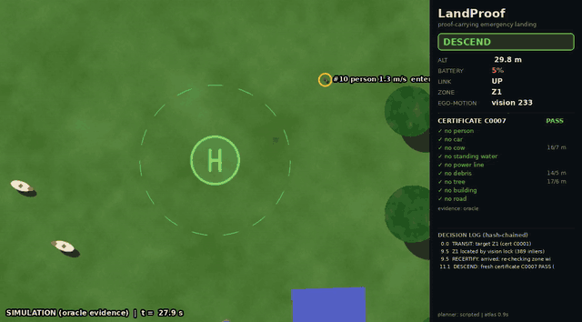
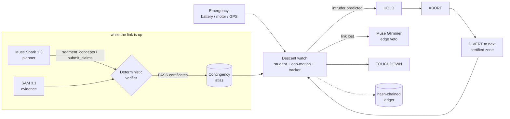

# LandProof

**Proof-carrying emergency landing for drones.** When a drone must land *now*, LandProof
lands it only where every safety claim has survived pixel evidence, and it keeps
checking all the way down.

> To a drone, a flooded street looks like the perfect runway.



*Simulation shown above, with oracle evidence (no API key). The real stack swaps in
SAM 3.1 evidence, Muse Spark planning, a SAM-distilled student and Muse Glimmer.*

---

## The problem

Battery critical, motor fault or GPS loss: a drone that cannot fly home has to come
down within seconds. Today's `LAND` failsafe descends straight down onto whatever is
below it. Research systems choose a site first, but they recognise a **fixed list of
classes** (SafeLand [TUM 2026] uses 20). They have no word for:

- **floodwater**: in a Chennai monsoon the flattest, smoothest open patch is often water;
- **a power line**: a fixed model sees an open, dry field;
- **a cow, a tarpaulin, a vendor's umbrella, a child lying on the grass.**

Asking an LLM "is this safe?" is not the answer either. It is slow (tens of seconds),
it can be wrong, and nobody can audit it.

## What LandProof does

| Layer | When | What | Meta model |
|---|---|---|---|
| **Contingency atlas** | healthy flight, in the background | Spark looks at the scene, chooses the hazards that matter *here* (from a vetted vocabulary), proposes zones and makes **falsifiable claims** ("no standing water within 5.4 m of Z2"). | **Muse Spark 1.3** (vision, tool calling, structured output) |
| **Proof** | per claim | SAM 3.1 segments each claimed-absent hazard. A deterministic verifier refutes any claim with an instance inside radius + class buffer. Mandatory classes are always checked. A zone is certified only if **every** claim survives. | **SAM 3.1** (Meta Model API) |
| **Descent watch** | every frame, onboard | A student model trained only on SAM 3.1 pseudo-labels, plus ego-motion compensation and ground-frame tracking. It predicts when a person will walk into the zone, then **holds**, **aborts** and **diverts** to the next certified zone, skipping any zone on the intruder's path. | student distilled from **SAM 3.1** |
| **Edge mode** | cloud link lost | Muse Glimmer re-checks the zone crop with a structured yes/no. It can **veto**, never approve. | **Muse Glimmer** (open weights, vLLM) |
| **Human override** | any time | The operator's spoken "stop", in English, Tamil or Hindi, aborts immediately. The human outranks every model. | **Muse Voice Transcribe** |
| **HazardForge** | offline | Muse Image inserts traps into real frames. SAM 3.1 must confirm every trap before it counts. Spark designs the next round from what fooled the system. | **Muse Image**, **SAM 3.1**, **Muse Spark** |

**Authority order:** human > deterministic verifier > student > LLM.
**The LLM never flies the drone.** Every decision is written to a hash-chained,
tamper-evident ledger.



## What is new compared with prior work

| Prior work | What it does | LandProof adds |
|---|---|---|
| SafeLand, TUM/MCML/Fraunhofer, arXiv 2603.17430 | closed-loop landing, 20 fixed classes, person abort, 57/60 field landings | open vocabulary, chosen per scene; certificates; predicted intrusion; divert away from the intruder's path |
| Drones that Think on their Feet, arXiv 2510.00167 | VLM ranks crops, 75% safe in urban scenes, 3.8–25.8 s per decision | the VLM only *proposes*; SAM evidence decides; nothing slow is on the critical path |
| See&Say, arXiv 2604.13292 | LLM rewrites open-vocabulary prompts for DINO-X | prompts constrained to a **vetted vocabulary** (free-form LLM prompts lower mIoU, arXiv 2606.21863); edge student |
| SAM 3 concept-verification study, arXiv 2605.09591 | SAM 3 accepts false concepts 21–66% of the time | claims are checked per zone with class buffers; validation stats per phrase (`01_validate_vocab.py`) |
| SAM3 → UAV student, arXiv 2607.03754 | offline distillation | the student is one layer of a verified landing loop; HazardForge traps feed student v2 |

## Built during the hackathon

Everything in this repository was written between **Oct 27 and Nov 4, 2026** for the
Meta Global AI Developer Hackathon; see the commit history. Earlier projects (for
example Aerial Guardian) are **not** included. Ego-motion compensation and tracking
were re-implemented from scratch in `landproof/perception/`.

## Results

> Fill the tables below from your own runs. `runs/*/landbench_table.md` is generated
> by `scripts/07_landbench.py`.

**Logic check (synthetic world, oracle evidence, no learning involved).** This shows
that the decision logic avoids the traps when evidence is perfect. It is **not** a
perception result.

| strategy | frames | safe-landing rate | false-safe rate | abstain | top unsafe causes |
|---|---|---|---|---|---|
| blind-LAND | 60 | 48% | 52% | 0% | water (17), road (7), building (4) |
| flattest-patch | 60 | 57% | 43% | 0% | water (14), obstacle (8), road (4) |
| fixed-vocab (UAVid classes, perfect masks) | 60 | 72% | 28% | 0% | water (11), wire_pole (6) |
| landproof | 60 | 98% | 0% | 2% | - |

_60 random camera views (25–70 m) over 3 procedurally generated monsoon scenes; evidence = ground-truth oracle. The fixed-vocabulary row uses **perfect** masks for UAVid's classes, so its failures (water, wires) come from vocabulary alone._

**Perception results with SAM 3.1 evidence and the distilled student.** Run these with
your API key:

| experiment | metric | value |
|---|---|---|
| student trained on SAM 3.1 labels only vs GT-trained student (FloodNet val) | mIoU, % of GT-trained | _run 03_ |
| student speed, laptop GPU / A10G | FPS at 512 px | _run 03_ |
| LandBench on FloodNet test, SAM 3.1 evidence | false-safe rate: flattest-patch vs fixed-vocab vs LandProof | _run 07_ |
| HazardForge round 1 → round 2 (student v1 → v2) | trap fooled-rate | _run 06_ |
| descent watch, sim with intruders | reaction lead (hold before the person enters the buffer) | `summary.json → reaction_lead_s` |

## Quickstart

```bash
git clone https://github.com/SANGRAMLEMBE/landproof && cd landproof
python -m venv .venv && source .venv/bin/activate
pip install -e ".[student,dev]"
pytest                                   # 27 offline tests, about a minute on CPU

# offline demo: no keys, oracle evidence, clearly labelled on the HUD
python scripts/05_descent_demo.py --evidence oracle --student oracle --glimmer oracle
# -> runs/demo/landing.mp4, ledger.jsonl, summary.json
```

**With Meta models:**

```bash
cp .env.example .env                     # add MODEL_API_KEY; spend is capped at LANDPROOF_BUDGET_USD (docs/BUDGET.md)
python scripts/00_check_access.py        # go/no-go for sam-3.1 + muse-spark-1.3 (~$0.01)
python scripts/04_build_atlas.py --image frame.jpg --alt 60 --planner spark   # watch Spark use the tools
python scripts/05_descent_demo.py --evidence meta-api --planner spark --student checkpoints/student_sam.pt --glimmer remote
python scripts/08_shadow_mode.py --video DJI_0042.MP4 --srt DJI_0042.SRT      # real footage, nothing flown
```

The full pipeline (vocabulary validation → auto-labelling → student → HazardForge →
LandBench) is in [docs/RUNBOOK.md](docs/RUNBOOK.md).

## Repository map

```
landproof/
  agents/atlas_agent.py      Muse Spark tool-calling planner (segment_concepts, propose_zones, submit_claims, finalize_atlas)
  verifier.py, claims.py     falsifiable claims -> SAM 3.1 evidence -> certificates
  meta/sam.py                SAM 3.1 via Meta Model API (Responses API + meta-sam-parser), open-weights and oracle backends
  meta/spark.py, image.py    Muse Spark 1.3, Muse Image 1.0 clients
  meta/glimmer.py            Muse Glimmer edge veto (vLLM, structured JSON)
  scorer.py                  per-class-buffer clearance map -> candidate zones
  descent/watch.py           TRANSIT -> RECERTIFY -> DESCEND <-> HOLD -> ABORT -> DIVERT -> TOUCHDOWN
  perception/                ego-motion (ORB+RANSAC, movers masked), ground tracker, LR-ASPP student, training
  forge/hazardforge.py       Muse Image traps verified by SAM 3.1
  bench/                     LandBench strategies + metrics
  sim/                       synthetic monsoon world, closed-loop replay simulator, real-footage source
  ledger.py                  hash-chained decision log
modal_apps/                  Glimmer on vLLM (L40S, FP8), student training on A10G
scripts/00..08               go/no-go, validate vocab, autolabel, train, atlas, demo, forge, bench, shadow mode
```

## Responsible AI

- **The LLM never flies the drone.** Spark plans before the emergency. Glimmer can only
  veto. Certificates come from deterministic geometry over SAM masks.
- **Fail-safe defaults.** A backend error is never treated as evidence of absence. Model
  disagreement is treated as uncertainty, and the fallback is hold, climb or hover and ask
  a human.
- **Auditability.** Every claim, certificate, state transition and agent tool call is in a
  hash-chained ledger (`verify_chain`).
- **Honesty in the demo.** Every frame is labelled SIMULATION or REPLAY OF REAL FOOTAGE
  (shadow mode) and names its evidence backend. Oracle results are never presented as
  SAM results.
- **Privacy.** People are outlined for safety only. No identity, no faces, nothing
  persisted beyond the run. Never send footage of people to `-contributor` model tiers.
- **Civilian scope.** Built for emergency landing of delivery, relief and inspection
  drones. Not for any military or surveillance use (see the SAM and Muse licences).
- **Flight rules (India).** Own footage is flown with a drone of 250 g or less, in Digital
  Sky green zones, over private land with consent. No autonomous flight in public spaces.

## Data and licences

Code: Apache-2.0. Datasets are **not** redistributed; the loaders expect your own
downloads.

| dataset | licence | used for |
|---|---|---|
| FloodNet | CC BY-SA 4.0 | flood traps, bench, demo stills |
| ICG Semantic Drone | research only, no redistribution | bench, people and dogs at 5–30 m |
| UAVid | CC BY-NC-SA 4.0 | optional pre-training (oblique view) |
| UDD6 | non-commercial | optional training |

The student uses torchvision LR-ASPP MobileNetV3 (BSD-3; ImageNet backbone weights).
`meta-sam-parser` is distributed under the SAM License. SAM 3.1, Muse Spark, Muse
Image and Muse Glimmer are used under their respective Meta terms.

## Limitations

- The simulator renders a 2-D orthophoto: no parallax, and no 3-D obstacles above
  ground level apart from what is drawn. Flatness is not measured; there is no depth model.
- SAM recall on very small people at high altitude is the weakest link. The verifier
  re-checks zones on an upsampled crop, and the descent watch keeps checking as the
  drone gets closer.
- Glimmer is a 30B model and runs on an edge-box class GPU (Modal, as a stand-in), not on
  a small drone.
- Shadow mode evaluates decisions on real footage. It is not autonomous flight.
